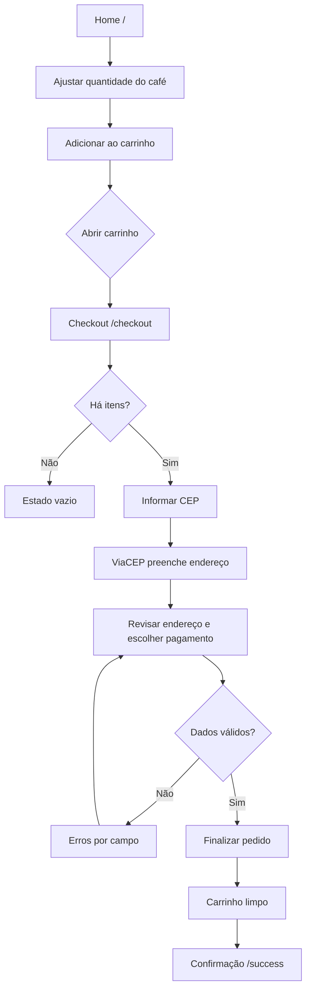

# PRD_SPEC — Coffee Delivery

| Campo | Valor |
| --- | --- |
| Versão | 1.0 |
| Status | **Proposta para validação** |
| Atualizado em | 2026-11-23 |
| Origem das diretrizes | `diretrizes_para_o_assistente_de_ia_coffee_delivery.md` (intitulado `AGENTS.md`) |
| Documentos relacionados | `TECH_SPEC.md`, `TASKS_SPEC.md` |

> **Nota do Arquiteto:** o arquivo de diretrizes cita os identificadores `RF-01` a `RF-16` e `RN-01` a `RN-10`, mas não descreve cada um. O conteúdo abaixo é a **proposta inicial** de baseline. A aprovação deste documento é o que permite iniciar a implementação sem "alterar requisitos sem antes atualizar os documentos", conforme a regra das diretrizes.

---

## 1. Visão geral

O **Coffee Delivery** é uma SPA (Single Page Application) de e-commerce para uma cafeteria fictícia. O cliente navega por um catálogo de cafés, escolhe quantidades, monta um carrinho persistido, informa um endereço de entrega (com preenchimento automático a partir do CEP), seleciona uma forma de pagamento **fictícia** e visualiza a confirmação do pedido.

A aplicação é **frontend-only**: não há backend próprio, banco de dados, login ou gateway de pagamento real. Todo o catálogo é local; a única integração externa é a consulta pública de CEP (ViaCEP).

### 1.1 Público-alvo e problema resolvido

- **Público:** clientes da cafeteria que desejam pedir cafés para entrega de forma rápida, inclusive em dispositivos móveis.
- **Problema:** o processo de pedido precisa ser simples, sem cadastro, com o endereço preenchido automaticamente e com total claro antes da confirmação.
- **Diferencial esperado:** identidade visual própria (logo original, tipografias Baloo 2 e Roboto), tema claro/escuro e acessibilidade básica (WCAG 2.2 AA).

## 2. Escopo

### 2.1 Dentro do escopo

- Catálogo local de cafés com nome, descrição, tags, preço e imagem.
- Seletor de quantidade e adição ao carrinho.
- Carrinho com ajuste/remoção de itens e persistência em `localStorage`.
- Cálculo de subtotal, taxa de entrega e total em BRL.
- Formulário de endereço com validação e consulta ViaCEP.
- Seleção de forma de pagamento fictícia.
- Confirmação do pedido com resumo em rota dedicada.
- Alternância de tema claro/escuro com persistência.
- Layout mobile-first e navegação por teclado.

### 2.2 Fora do escopo

- Backend, API própria, banco de dados ou autenticação/login.
- Pagamento real, coleta de dados de cartão ou gateway de pagamento.
- Gestão de estoque, cupons, frete dinâmico ou múltiplos endereços.
- Histórico de pedidos persistido entre sessões (o pedido confirmado vive em memória).
- Internacionalização (a interface é em português do Brasil).

---

## 3. Fluxos

### 3.1 Fluxo principal (caminho feliz)

1. O cliente acessa `/` e vê o catálogo.
2. Ajusta a quantidade desejada de um ou mais cafés e os adiciona ao carrinho.
3. Acessa `/checkout` pelo link/badge do carrinho e revisa os itens e o resumo financeiro.
4. Informa o CEP; o sistema consulta o ViaCEP e preenche logradouro, bairro, cidade e UF.
5. Confere/ajusta o endereço, informa número (e complemento, se quiser) e escolhe a forma de pagamento.
6. Clica em **Finalizar pedido**. O sistema valida, cria o pedido, limpa o carrinho e redireciona para `/success`.
7. A tela de sucesso exibe número do pedido, itens, total, endereço e pagamento, com link para a home.

### 3.2 Fluxos alternativos e de erro

| ID | Situação | Comportamento esperado |
| --- | --- | --- |
| FA-01 | CEP com menos de 8 dígitos | Nenhuma consulta é disparada; validação de formato ao tentar enviar. |
| FA-02 | ViaCEP indisponível, timeout ou `erro: true` | Nenhum campo é preenchido; o cliente pode digitar endereço manualmente e seguir com o pedido. |
| FA-03 | Campos obrigatórios vazios/inválidos | Envio bloqueado, mensagens por campo, foco no primeiro campo inválido. |
| FA-04 | Carrinho vazio em `/checkout` | Estado vazio com link para a home; botão **Finalizar pedido** desabilitado. |
| FA-05 | Recarregar a página | Carrinho e tema são restaurados do `localStorage`; o pedido **não** é restaurado. |
| FA-06 | Acessar `/success` sem pedido em andamento | Redirecionamento para `/`. |
| FA-07 | Rota desconhecida | Redirecionamento para `/`. |
| FA-08 | `localStorage` corrompido ou indisponível | Dados inválidos são descartados; a aplicação continua com estado inicial seguro. |
| FA-09 | Alternar tema | Preferência aplicada imediatamente e persistida para a próxima visita. |

---

## 4. Requisitos funcionais

Cada requisito traz critérios **verificáveis** (observáveis em execução ou inspeção de estado).

### RF-01 — Catálogo disponível na Home

**Descrição:** a rota `/` apresenta o catálogo de cafés a partir de uma fonte de dados local.

**Critérios verificáveis:**
- [ ] Ao acessar `/`, há um card para cada café cadastrado na fonte de dados local.
- [ ] A quantidade de cards é igual à quantidade de registros da fonte, sem duplicatas.
- [ ] Com `localStorage` limpo, a home carrega sem erros no console.

### RF-02 — Detalhes do café no catálogo

**Descrição:** cada card apresenta as informações essenciais do produto.

**Critérios verificáveis:**
- [ ] Cada card exibe nome, descrição, preço formatado em BRL e imagem com `alt` significativo.
- [ ] As tags do café (ex.: "Tradicional", "Expresso") são exibidas como texto legível.
- [ ] Nenhum card mostra `NaN`, `undefined` ou preço sem símbolo `R$`.

### RF-03 — Seletor de quantidade no catálogo

**Descrição:** o cliente ajusta a quantidade antes de adicionar ao carrinho.

**Critérios verificáveis:**
- [ ] O botão de incremento aumenta o valor exibido em 1 por clique.
- [ ] O botão de decremento diminui o valor em 1, nunca abaixo de 1.
- [ ] Quando a quantidade é 1, o botão de decremento está desabilitado.

### RF-04 — Adicionar café ao carrinho

**Descrição:** o botão de adição usa a quantidade selecionada no card.

**Critérios verificáveis:**
- [ ] Ao clicar em adicionar, o carrinho passa a conter o café com a quantidade selecionada.
- [ ] Ao adicionar novamente o mesmo café, a quantidade existente é somada (sem criar outro item).
- [ ] O feedback visual de adição é percebido na interface (badge do carrinho atualizado).

### RF-05 — Carrinho no cabeçalho

**Descrição:** o cabeçalho indica a quantidade total de itens e dá acesso ao checkout.

**Critérios verificáveis:**
- [ ] O badge mostra a soma das quantidades de todos os itens do carrinho.
- [ ] Com carrinho vazio, o badge exibe `0` (ou fica oculto) e não exibe número negativo.
- [ ] O link do carrinho leva à rota `/checkout`.

### RF-06 — Itens do carrinho no Checkout

**Descrição:** a rota `/checkout` lista os itens com as informações necessárias para revisão.

**Critérios verificáveis:**
- [ ] Cada linha exibe imagem, nome, preço unitário, quantidade, subtotal do item e ação de remover.
- [ ] A listagem reflete imediatamente adições, ajustes e remoções feitas no carrinho.
- [ ] Itens com quantidade zero não aparecem.

### RF-07 — Ajustar quantidade no carrinho

**Descrição:** o cliente altera a quantidade de um item dentro do checkout.

**Critérios verificáveis:**
- [ ] Incrementar aumenta a quantidade em 1 e recalcula o subtotal do item e do pedido.
- [ ] Decrementar de 2 para 1 mantém o item; decrementar de 1 remove o item da lista.
- [ ] Não é possível persistir item com quantidade menor que 1.

### RF-08 — Persistência do carrinho

**Descrição:** o carrinho sobrevive a recarregamentos da página.

**Critérios verificáveis:**
- [ ] Após adicionar itens e recarregar, os mesmos itens e quantidades reaparecem.
- [ ] Após esvaziar o carrinho e recarregar, nenhum item reaparece.
- [ ] Dados inválidos no `localStorage` são ignorados sem quebrar a aplicação.

### RF-09 — Resumo financeiro

**Descrição:** o checkout apresenta subtotal, taxa de entrega e total.

**Critérios verificáveis:**
- [ ] Os três valores são exibidos em BRL com duas casas decimais.
- [ ] O total é igual a `subtotal + taxa de entrega` (regra RN-02).
- [ ] Com carrinho vazio, o resumo não apresenta valores negativos ou `NaN`.

### RF-10 — Navegação entre rotas

**Descrição:** a aplicação expõe `/`, `/checkout` e `/success`.

**Critérios verificáveis:**
- [ ] Cada rota renderiza sua respectiva página sem recarregar o documento.
- [ ] A rota `/checkout` é acessível diretamente pelo navegador (fallback SPA do Vite).
- [ ] Qualquer rota não cadastrada redireciona para `/`.

### RF-11 — Consulta automática de CEP

**Descrição:** ao informar um CEP válido, o endereço é preenchido automaticamente via ViaCEP.

**Critérios verificáveis:**
- [ ] Com 8 dígitos válidos, são preenchidos logradouro, bairro, cidade e UF.
- [ ] O campo CEP aceita `00000-000` e também `00000000` (normalização para dígitos).
- [ ] Durante a consulta há feedback de carregamento; em falha, os campos continuam editáveis.
- [ ] O preenchimento automático não impede edição manual posterior.

### RF-12 — Formulário de endereço

**Descrição:** o checkout coleta os dados de entrega necessários.

**Critérios verificáveis:**
- [ ] Estão presentes os campos: nome completo, CEP, logradouro, número, complemento, bairro, cidade e UF.
- [ ] O complemento é o único campo opcional do endereço.
- [ ] Todos os campos têm rótulo associado (ou `aria-label` equivalente).

### RF-13 — Validação do formulário

**Descrição:** os dados são validados no cliente antes da finalização.

**Critérios verificáveis:**
- [ ] Campos obrigatórios vazios exibem mensagem específica ao tentar enviar.
- [ ] Campos inválidos são marcados com `aria-invalid` e apresentam `role="alert"` ou equivalente.
- [ ] O envio só ocorre quando todos os campos e a forma de pagamento são válidos.
- [ ] Ao submeter um formulário inválido, o foco vai para o primeiro campo com erro.

### RF-14 — Forma de pagamento fictícia

**Descrição:** o cliente escolhe uma opção de pagamento simulada.

**Critérios verificáveis:**
- [ ] São exibidas exatamente três opções: Cartão de Crédito, Cartão de Débito e Dinheiro.
- [ ] Apenas uma opção pode estar selecionada por vez.
- [ ] Nenhum campo de dados bancários ou de cartão é solicitado.
- [ ] A seleção é obrigatória para finalizar o pedido.

### RF-15 — Finalização do pedido

**Descrição:** a confirmação cria um pedido, limpa o carrinho e navega para a confirmação.

**Critérios verificáveis:**
- [ ] Com formulário válido e carrinho não vazio, o clique em finalizar leva à rota `/success`.
- [ ] O pedido criado contém snapshot dos itens, endereço, pagamento e totais.
- [ ] Após a finalização, o carrinho está vazio (inclusive após recarregar a página).
- [ ] Com carrinho vazio ou formulário inválido, nenhum pedido é criado.

### RF-16 — Tema claro e escuro

**Descrição:** o cliente alterna entre os temas e a preferência é lembrada.

**Critérios verificáveis:**
- [ ] Existe um controle de alternância acessível por teclado em todas as páginas.
- [ ] Alternar muda imediatamente fundos, textos, bordas, inputs e botões (sem elementos "claros" no tema escuro).
- [ ] Após recarregar, o tema escolhido permanece.
- [ ] Na primeira visita, o tema inicial respeita `prefers-color-scheme` quando disponível.

---

## 5. Regras de negócio

| ID | Regra | Validação / efeito |
| --- | --- | --- |
| **RN-01** | Todo valor monetário é armazenado como inteiro em **centavos** e formatado em BRL (`pt-BR`) com duas casas decimais. | Nenhum cálculo usa ponto flutuante; a UI nunca exibe mais ou menos de duas casas. |
| **RN-02** | A taxa de entrega é fixa em **R$ 3,50** (350 centavos) por pedido, cobrada uma única vez. | `total = subtotal + 350`; com carrinho vazio, `total = 0`. |
| **RN-03** | A quantidade mínima por item é **1**. No catálogo o decremento é desabilitado em 1; no carrinho, decrementar de 1 **remove** o item. | Nenhum item com quantidade ≤ 0 é mantido no estado ou persistido. |
| **RN-04** | Adicionar um café já presente **soma** quantidades. A identidade do item é o `coffeeId`. | O carrinho nunca contém duas linhas com o mesmo `coffeeId`. |
| **RN-05** | Não é possível finalizar com carrinho vazio. `/checkout` exibe estado vazio e `/success` sem pedido em memória redireciona para `/`. | Botão de finalização desabilitado e nenhum `Order` criado. |
| **RN-06** | O CEP deve ter 8 dígitos (formato `00000-000` ou `00000000`). ViaCEP é consultado somente com 8 dígitos válidos; erro, timeout ou `erro: true` não bloqueia o preenchimento manual. | Campos automáticos (logradouro, bairro, cidade, UF) podem ser sobrescritos pelo usuário. |
| **RN-07** | São obrigatórios: nome completo, CEP válido, logradouro, número, bairro, cidade e UF (2 letras). Complemento é opcional. | Formulário inválido impede a finalização. |
| **RN-08** | As únicas formas de pagamento são: Cartão de Crédito, Cartão de Débito e Dinheiro. É obrigatório selecionar uma, e a opção não altera o valor do pedido. | Nenhum dado financeiro real é coletado ou enviado. |
| **RN-09** | Ao finalizar, gera-se um `Order` com id único, `createdAt` ISO, snapshot dos itens (nome, preço unitário, quantidade), endereço, pagamento, subtotal, taxa e total. O carrinho é limpo **somente após** a criação bem-sucedida do pedido. | O pedido existe apenas em memória, durante a sessão. |
| **RN-10** | Apenas **carrinho** e **preferência de tema** são persistidos em `localStorage`, em chaves versionadas. Dados de pedido, endereço ou pagamento não são persistidos. | Estado inválido no storage é descartado e substituído pelo estado inicial. |

---

## 6. Requisitos não funcionais

| ID | Requisito |
| --- | --- |
| RNF-01 | **Responsividade mobile-first**, testável em 320 px, 375 px, 768 px e 1280 px+, sem rolagem horizontal involuntária. |
| RNF-02 | **Acessibilidade WCAG 2.2 AA:** labels associados, navegação por teclado, foco visível, contraste adequado e mensagens de erro claras. |
| RNF-03 | **Identidade visual:** logo original da marca e tipografias Baloo 2 (títulos) e Roboto (texto corrido). |
| RNF-04 | **Tema por tokens semânticos:** nenhum elemento pode usar cor fixa que deixe de funcionar em light/dark. |
| RNF-05 | **Idioma:** conteúdo em português do Brasil (`pt-BR`). |
| RNF-06 | **Qualidade:** TypeScript em modo estrito, sem `any`, com imutabilidade no reducer e nos hooks. |
| RNF-07 | **Verificação:** `npm run build` e `npm run lint` devem passar ao final de cada tarefa. |

## 7. Glossário

| Termo | Significado |
| --- | --- |
| **Café (`Coffee`)** | Produto do catálogo local, com preço em centavos. |
| **Carrinho (`CartItem`)** | Item selecionado pelo cliente, identificado por `coffeeId` + quantidade. |
| **Pedido (`Order`)** | Snapshot imutável do carrinho, endereço, pagamento e totais no momento da finalização. |
| **Centavos** | Unidade inteira usada em todos os cálculos monetários (ex.: `350` = R$ 3,50). |
| **ViaCEP** | API pública consultada pelo CEP para preencher endereço. |
| **Token semântico** | Variável de tema (ex.: `background`, `surface`, `text`) usada pelos estilos no lugar de cores literais. |
| **Snapshot** | Cópia dos dados no instante da finalização, imune a mudanças posteriores no carrinho. |
